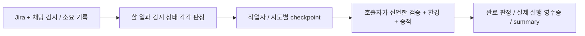

# 감시·작업 결과·완료 검증·측정



## 감시

`guard-last.json.idle`은 지금 실행할 일이 없다는 기존 의미다. `monitoringStatus=unavailable`이면 채팅 감시(`teams_room.py`, 채팅 방을 설정한 경우)가 실패한 상태다. stdout의 `skipping duplicate (monitoring-unavailable: …)`와 일지 `monitoring-unavailable(guard)`가 이를 표시한다. `skipping duplicate`는 기존 waker가 모델을 깨우지 않는 계약이다. Jira 이벤트, 큐, 승인, pending focus, 환경 복구는 계속 처리한다.

채팅 감시 결과(`teams-scan.json`)의 `monitoring`은 `lastSuccessAt`, 정제된 `error`, 연속 `failures`, `retryAt`, `cooldown`을 기록한다. 첫 실패 후 **1800초**, 다음 실패부터 **3600초** 동안 채팅만 읽지 않는다. 성공하면 실패 이력이 초기화된다. 기준점(mark)과 미처리 이벤트는 유지한다. 즉시 다시 읽으려면 `python3 scripts/teams_room.py scan --dir "$D" --force-refresh` 또는 `followup_idle.py --dir "$D" --force-refresh`를 쓴다.

`followup-scan.json.timings`는 search/inflight/intake/view/related의 초 단위 소요와 totalSeconds, `attempts`는 실제 CLI 호출 수다. view의 기존 **한 번 재시도 + 3초**는 유지한다. 검색 재시도나 호출 timeout을 늘리지 않는다. `guard-last.json.timings`는 scan, triage, 채팅 감시, needs별 preflight, 전체 소요를 기록한다.

## 호출자가 선언하는 완료 조건

오케스트레이터는 작업자 실행 **전**, 승인된 brief의 KEY·stage·검증·환경을 JSON으로 선언한다. 작업자가 필요한 검증을 지우거나 생략할 수 없다.

```json
{"key":"PROJ-1","stage":"dev-deployed","checks":[{"name":"runtime","artifact":"runtime.json","resultField":"status","environment":{"environment":"dev"}}]}
```

artifact는 선언 파일 디렉터리 기준이다. resultField와 environment의 키는 점으로 연결한 JSON 필드 경로다. 환경은 최소 한 필드의 정확한 값으로 검증한다. 예를 들어 preflight의 `vpn`만으로 런타임 검증을 대체하지 않는다. 검사마다 실제 검증기가 쓰는 PASS 필드와 환경 필드를 지정한다. 검증 JSON에 없는 필드는 `verifier-field-missing:<필드>`로 실패한다(`check_deploy.py`는 `job`·`build`·`context`, `--key`를 주면 `key`). Jenkins·serving·API·브라우저가 필요하면 각각 선언한다.

`jira-worker … --requirements <선언>`은 실행 전에 선언을 메모리에 복사해 판정한다. 기존 worker schema는 그대로다. 각 필수 check가 **정확히 한 번 PASS**, result의 KEY·stage 일치, `status=done`, `waiting=null`, artifact 목록에 증적 포함, 읽을 수 있는 검증 JSON의 PASS와 환경 일치가 모두 필요하다. done 결과에 누락·FAIL·SKIP·중복·환경 불일치·파일 없음이면 exit 4다. waiting/failed는 원래 프로세스 종료 코드를 유지하고 stageComplete=false를 기록한다. 결과를 고치거나 통과한 증적을 삭제하지 않는다.

작업자 종료 후 `drain.py --dir "$D" --token "$T" check-result --key <KEY> --result <결과> --requirements <같은 선언> --worker-metadata <결과>.worker.json`을 실행한다. `stageComplete=true`와 exit 0을 확인한 뒤에만 stage 전진·`processed`를 한다. 실패는 `retryAllowed=false`, gate sidecar에 통과/차단 증적을 남기고 `waiting=human-risk`로 둔다. 선언이 없는 예전 호출의 check-result 계약은 유지한다. 요금 제한 판정과 항목별 backoff가 먼저 적용된다.

## 선택 정리 전에 결과 보존

작업자마다 `runs/<token>/attempt-*/checkpoint.json` 경로를 먼저 만든다(토큰 없는 예전 호출도 runs/manual 아래 생성). 프롬프트는 끝내기 전에 완전한 schema JSON을 그 경로에 쓰도록 요구한다. 작업자는 worktree·merge 브랜치를 정리하지 않고 `artifacts`에 `cleanup:<경로>`로만 남긴다(오케스트레이터가 `scratch_cleanup.py --result`로 지운다). `stdout.json`, `worker.json`, `gate.json`, `requirements-snapshot.json`은 같은 시도 디렉터리의 증적이다. 기존 stdout·결과 파일 계약도 유지한다.

작업자 exit ≠0·timeout이어도 유효한 checkpoint는 `worker.json.recoveryEvidence`로 보존한다. 다른 KEY·오래된 mtime·잘못된 schema는 거부한다. **보존은 실행 성공이 아니다.** 종료 코드와 `stageComplete=false`를 유지하며 잠금을 해제하지 않는다. Paseo 대기 timeout 뒤 클라이언트가 멈추면 30초 유예 후 종료하고 exit 124를 기록한다. 하위 작업자가 살아 있을 수 있으므로 기존 lost-run/소유권 확인 절차를 따른다. 거부된 명령은 동등한 명령으로 우회하지 않는다.

## 실제 실행과 선택 측정

래퍼는 실제 시작·끝 epoch, 소요, processExitCode, 최종 exitCode, outcome, 결과/checkpoint 유효성을 자동 기록한다. `<기존 결과>.worker.json`은 마지막 시도 포인터이고 시도별 `worker.json`은 계속 남는다. summary-record는 재시도 전에 호출한다.

```bash
python3 scripts/drain.py --dir "$D" --token "$T" summary-record \
  --key PROJ-1 --unit runtime --started-at <epoch> --ended-at <epoch> \
  --workers 1 --runtime --result <기존 결과 JSON>
```

아침 점검처럼 키·전진할 stage가 없는 단위는 worker·summary-record에서 --key를 생략하고 기존 선언 없는 경로를 쓴다. `--result`가 실제 래퍼의 영수증을 summary에 붙인다. `--worker-metadata <시도별 worker.json>`도 가능하다. durationSeconds는 단위 소요의 합, wallElapsedSeconds는 실행 시작부터 기록 종료까지의 벽시계 시간이다. `(key,unit,startedAt)`가 같은 기록은 한 번만 합산하고 충돌은 거부한다. 작업자를 폴링한 횟수는 사람 개입이 아니다.

토큰·비용·사람 개입·대기·재작업은 증명 가능한 관찰이 없으면 **null/unknown**이다. 운영자가 provider usage 또는 명시적 사람 행동/대기 시작·종료/재작업 로그에서 직접 측정한 JSON을 `--observations <파일>`로 summary-record에 전달할 수 있다. 모델이 수치나 과거 대기를 추정해 파일을 만들지 않는다.

```json
{"source":"측정 원본 파일 또는 provider usage 식별자","tokens":100,"cost":0.01,"currency":"USD","humanInterventions":1,"waitingSeconds":10,"reworkAttempts":1}
```

필드는 선택이며 없는 값은 0이 아니다. 비용에는 currency, 관찰에는 source가 필요하다. summary는 knownSubtotal·knownUnits·unknownUnits와 완전한 total을 나누고, 서로 다른 통화는 통화별로만 합산한다. `decisions.jsonl`의 실제 사람 결정 줄(`by=button`·`by=todo-app`)은 실행 시간 범위 안에서 중복 제거해 `humanInterventions.buttonDecisions`로 별도 자동 기록한다. 채팅 답장 승인 뒤 자동 발송(`CHAT_SEND_CMD`) 영수증은 사람 행동에 포함하지 않는다. 파일이 없거나 손상되면 unknown이다. env-human 폴링·큐 생성 시각에서 사람 개입이나 과거 대기 시간을 만들지 않는다.
